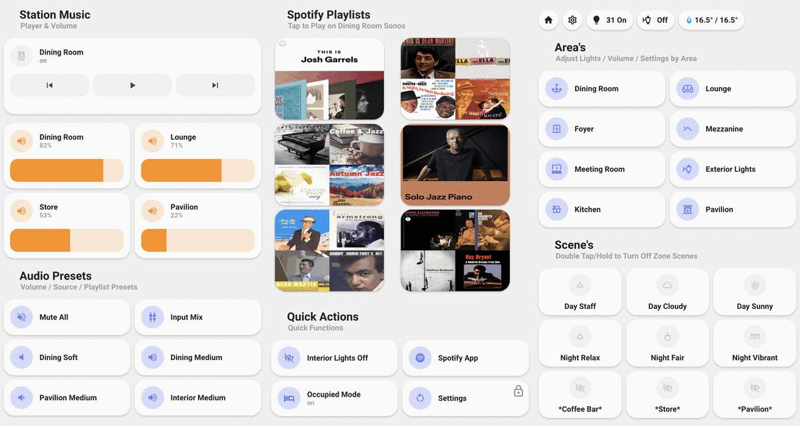

# viewtimeout

[](https://github.com/hacs/integration)

Returns to specified default view after activity
timeout [Home Assistant](https://www.home-assistant.io/)



## Important Info

* If you need to disable the timeout feature temporarily, add `?disable_timeout` to the end of your
  URL.
* Config is placed in the root of your dashboard/panel code: `view_timeout:` (see [Setup](#setup)).
* The timeout only runs on the dashboard that contains the `view_timeout:` config. Other dashboards,
  Settings, Developer Tools, add-ons etc. are never redirected.
* The timeout is paused while you are editing the dashboard.

## Dependencies

None required - card tools not required anymore

## Installation

### HACS (custom repository)

1. In HACS, open the menu (three dots, top right) and choose **Custom repositories**.
2. Add `https://github.com/BWilky/viewtimeout` with the category **Dashboard** (called **Lovelace** or
   **Plugin** in older HACS versions).
3. Search for **View Timeout** in HACS, download it, and reload your browser.

HACS adds the dashboard resource for you.

### Manual

1. Copy `timeout.js` to `/config/www/viewtimeout/timeout.js`.
2. Go to **Settings > Dashboards**, open the menu (three dots, top right), choose **Resources** and add
   `/local/viewtimeout/timeout.js` as a **JavaScript module**.
   (If you don't see **Resources**, enable *Advanced mode* in your user profile.)
3. Reload your browser (clear the cache or use a private window if the script doesn't load).

Alternatively, you can load it on every page with `frontend: extra_module_url:` in `configuration.yaml`:

```
frontend:
  extra_module_url:
    - /local/viewtimeout/timeout.js
```

## Setup

1. Open the dashboard you want the timeout on, click the pencil (edit), then the three dots and
   **Raw configuration editor**.
2. Add `view_timeout:` at the **top level**, next to `views:` (not inside a view).
3. Set `default:` to the **path** of the view to return to (the `path:` of that view, or its index
   such as `0` when it has no path). This is the view's path, not the dashboard name or the view title.
   For example, for the URL `/dashboard-tablet/home` the view path is `home`.
4. Save. The new settings apply right away.

Add the config to every dashboard that should time out. Each dashboard uses its own settings.

## Config Options

| Config Option | Type | Default | Description |
|:---------------|:---------------|:---------------|:----------|
|`timeout:`| Boolean | true | enables/disables the timeout feature.
|`default:` | String | home | view path to default back to after timeout. Set this to `null` and use `views` to allow for per-view only redirection.
|`duration:` | Number | 15000 | timeout in **milliseconds** (60000 = 1 minute)
|`reset:` | Object |  | gives access to activation choices
|`reset.mouse_move` | Boolean | false | resets the timeout when moving the mouse (or dragging on a touch screen)
|`reset.mouse_click` | Boolean | true | resets the timeout on clicks, taps, key presses and scrolling
|`users:` | Array |  | enable only for certain users, by user name or user id (otherwise leave blank)
|`views:` | Object |  | choose view redirection or disable their redirection (with "false")
|`close_dialogs:` | Boolean | true | close open dialogs (e.g. the more-info window of an entity) on timeout. On the default view, open dialogs are closed after the timeout too.
|`respect_visibility:` | Boolean | false | don't redirect to a view that is hidden from the current user (the view's `visible:` setting)
|`debug:` | Boolean | false | log what the timeout is doing to the browser console (see [Troubleshooting](#troubleshooting))

`reset.in_lovelace` from older versions is no longer needed and is ignored: the timeout now only ever
runs on the dashboard that contains the config.

## Simple config example

```
view_timeout:
  timeout: true
  default: home
  duration: 15000

views:
```

## Targeted config example

```
view_timeout:
  timeout: true
  default: null
  duration: 15000
  views:
    windows: home
    blinds: home

views:
```

## Full config example

```
view_timeout:
  timeout: true
  default: default_view
  duration: 15000
  close_dialogs: true
  respect_visibility: false
  debug: false
  reset:
    mouse_move: false
    mouse_click: true
  users:
    - My Username
  views:
    home: false
    first-camera: home
    second-camera: home

views:
```

## Troubleshooting

Open the browser console (F12, or remote debugging for a tablet / the companion app) and look for
`VIEWTIMEOUT` messages:

* `v1.3.0 started. Waiting for config...` - the script is loaded. If you don't see this, the resource is
  not set up correctly or your browser is using a cached version.
* `Active on /<dashboard> (Timeout: ...ms, default view: ...)` - the config was found. Check that the
  dashboard, duration and default view are what you expect.
* `View(s) not found on /<dashboard>: ...` - `default:` or a name under `views:` doesn't match any view.
  The message lists the view paths that exist.
* `Not active on /<dashboard>: user "..." is not in the users list` - the logged-in user is not in `users:`.
* No `Active on` message - there is no `view_timeout:` at the top level of this dashboard's config, or
  it has `timeout: false`.

For more detail, add `debug: true` to the config or `?debug_timeout` to the URL. It logs which view
you are on, where it will go, and every timer start, reset and redirect.

You can also run `window.ViewTimeout.status()` in the console to see the current state.

## TODO

- Per View settings (duration, default to different panel)
- Per User settings (that all settings can be different depending on the user)
